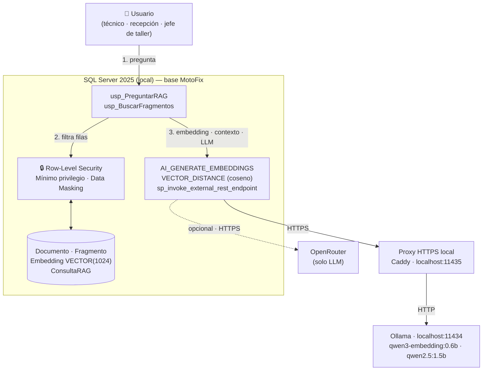
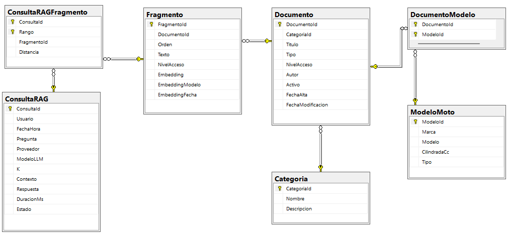

# 🏍️ MotoFix — RAG sobre SQL Server 2025

> Motor de conocimiento semántico con **Retrieval-Augmented Generation (RAG)** construido íntegramente dentro de **SQL Server 2025** y ejecutado **100 % en local** con modelos de **Ollama**. Proyecto de preparación para la certificación **Microsoft DP-800: SQL AI Developer Associate**.


**Informe completo con capturas:** [`MotoFix.pdf`](MotoFix.pdf)

---

## 📌 Descripción del proyecto

Las búsquedas tradicionales (`LIKE`, Full-Text Search) solo encuentran documentos que contienen **las mismas palabras** que la consulta. En una base de conocimiento esto provoca resultados irrelevantes, ausencia de resultados ante sinónimos y obliga al usuario a leer varios documentos para extraer una respuesta.

**MotoFix** resuelve este problema con un motor semántico sobre una base de conocimiento de un taller de motos ficticio (guías técnicas, incidencias y preguntas frecuentes). Un técnico pregunta en lenguaje natural, por ejemplo:

> *«¿Cómo puedo solucionar el error de conexión 18456?»*
> *«El manillar tiembla cuando voy rápido»*

y el sistema:

1. Convierte la pregunta en un **vector** (embedding).
2. Busca en SQL Server los fragmentos **semánticamente más cercanos** con `VECTOR_DISTANCE` (distancia coseno).
3. Construye un **contexto** con esos fragmentos.
4. Se lo entrega a un **LLM local** que responde **solo** con esa información y **citando las fuentes**.
5. **Registra** pregunta, fragmentos, contexto y respuesta para auditoría.

Además, cada usuario solo recupera los documentos a los que tiene permiso (**Row-Level Security**): la misma pregunta produce respuestas distintas según el rol.

> **RAG ≠ LLM.** Un LLM solo conoce lo que aprendió en su entrenamiento y no sabe nada de las políticas de tu empresa. **RAG = SQL Server + Vector Search + Contexto + LLM**: la respuesta se fundamenta en datos propios, verificables y auditables.

---

## ✅ Qué demuestra (DP-800)

**Nivel del proyecto: 3 — Avanzado.**

| Área | Implementación |
|---|---|
| **Diseño y desarrollo de BD** | 7 tablas con PK/FK/constraints, 4 vistas, 2 funciones, 2 triggers, 4 procedimientos, T-SQL avanzado |
| **Seguridad** | Row-Level Security por rol, mínimo privilegio (`GRANT`/`DENY`), Dynamic Data Masking, secretos fuera del repositorio |
| **Optimización** | Plan de ejecución, *logical reads*, índice filtrado y compuesto, reescritura de la consulta (24.133 → 3.616 lecturas) |
| **Modelos y embeddings** | `CREATE EXTERNAL MODEL` (Ollama), `AI_GENERATE_EMBEDDINGS`, columna `VECTOR(1024)` |
| **Intelligent Search** | Búsqueda vectorial con `VECTOR_DISTANCE('cosine', …)` y ranking, con filtros por categoría y tipo |
| **RAG** | `usp_PreguntarRAG`: pregunta → embedding → recuperación → contexto → LLM local → respuesta + trazabilidad |

**Decisiones técnicas clave**

- **Métrica: distancia coseno.** Compara la *dirección* del vector (el significado) y no su magnitud, por lo que no depende de la longitud del texto. Es la métrica estándar en embeddings de texto.
- **Unidad de recuperación: el fragmento (*chunk*).** Un embedding por documento completo mezcla temas; por fragmento, la búsqueda es precisa y al LLM solo se le envía lo relevante.
- **Embeddings sobre `Título + Texto`.** El título aporta contexto que un fragmento aislado puede no mencionar.
- **Modelos ligeros** (`qwen3-embedding:0.6b` y `qwen2.5:1.5b`) para que sea reproducible en prácticamente cualquier equipo.
- **El LLM se invoca con `sp_invoke_external_rest_endpoint`.** `CREATE EXTERNAL MODEL` solo admite modelos de tipo *embeddings*.

---

## 🏗️ Arquitectura



**Flujo RAG**

```
Pregunta → Embedding → VECTOR_DISTANCE en SQL Server (con RLS) → Top-K fragmentos
         → Contexto → LLM local → Respuesta con fuentes → Registro en ConsultaRAG
```

---

## 📁 Estructura del repositorio

```
DP-800-MotoFix-RAG-sobre-SQL-Server-25/
├── MotoFix.pdf                       Informe paso a paso con capturas
├── README.md
├── caddy/
│   └── Caddyfile                     Proxy HTTPS local delante de Ollama
├── database/
│   ├── 01_create_database.sql        Base de datos MotoFix
│   ├── 02_create_tables.sql          7 tablas
│   ├── 03_insert_data.sql            Datos de prueba
│   ├── 04_views_functions_triggers.sql
│   ├── 05_procedures.sql             Búsqueda semántica y RAG
│   ├── 06_security.sql               RLS, roles, GRANT/DENY, masking
│   └── 07_indexes_optimization.sql   Estudio de rendimiento
├── ia/
│   ├── 00_enable_features.sql        Activa external rest endpoint
│   ├── 01_create_external_model.sql  Modelo de embeddings (Ollama)
│   └── 02_generate_embeddings.sql    Rellena Fragmento.Embedding
├── tests/                            Pruebas y demostraciones
└── images/                           Capturas de ejecución
```

---

## 🗄️ Modelo de datos



| Tabla | Para qué sirve |
|---|---|
| `Documento` | Tabla central: guías, incidencias y preguntas frecuentes (FAQ), con su nivel de acceso |
| `Categoria` | Agrupa los documentos por área del taller (motor, eléctrico, frenos…) y permite filtrar |
| `ModeloMoto` | Catálogo de modelos de moto que atiende el taller (marca, modelo, cilindrada, tipo) |
| `DocumentoModelo` | Tabla intermedia **N:M**: un documento aplica a varios modelos y un modelo tiene varios documentos |
| `Fragmento` | **Pieza clave del RAG.** Trozos de texto de cada documento (*chunks*) con su `Embedding VECTOR(1024)`, el modelo que lo generó y su nivel de acceso |
| `ConsultaRAG` | Registro de auditoría: pregunta, usuario, modelo LLM, `K`, contexto, respuesta y duración |
| `ConsultaRAGFragmento` | Tabla intermedia: qué fragmentos se recuperaron en cada consulta, su `Rango` y su `Distancia` |

**Objetos de programación**

| Tipo | Objeto | Función |
|---|---|---|
| Vista | `vw_DocumentoResumen` | Documentos con categoría, nº de fragmentos, embeddings generados y modelos de moto asociados |
| Vista | `vw_FragmentoLectura` | Lectura segura de fragmentos (sin la columna vectorial, solo documentos activos) |
| Vista | `vw_FragmentoPendiente` | Fragmentos sin embedding (útil para procesos por lotes) |
| Vista | `vw_TrazaRAG` | Trazabilidad completa de cada consulta RAG |
| Función | `fn_DocumentosPorModelo(@ModeloId)` | Documentos activos aplicables a un modelo |
| Función | `fn_Extracto(@Texto, @Max)` | Recorta un texto con puntos suspensivos |
| Trigger | `trg_Documento_Actualizar` | Actualiza la fecha de modificación y propaga el nivel de acceso a los fragmentos |
| Trigger | `trg_Fragmento_InvalidarEmbedding` | Si cambia el texto de un fragmento, invalida su embedding para regenerarlo |
| Procedimiento | `usp_BuscarFragmentosPorVector` | Núcleo de la búsqueda (la consulta que se optimiza) |
| Procedimiento | `usp_BuscarFragmentos` | Pregunta en texto → embedding → top-K fragmentos |
| Procedimiento | `usp_PreguntarRAG` | Flujo RAG completo con trazabilidad (Ollama u OpenRouter) |
| Procedimiento | `usp_RegenerarEmbeddingsPendientes` | Recalcula los embeddings invalidados |

---

## 🚀 Guía paso a paso

> Sigue los pasos **en orden**. La guía detallada con todas las capturas está en [`MotoFix.pdf`](MotoFix.pdf).

---

## 📊 Resultados

| Métrica | Resultado |
|---|---|
| Datos de prueba | 8 categorías · 8 modelos de moto · 17 documentos · 42 fragmentos |
| Embeddings | 42/42 fragmentos con vector de 1024 dimensiones |
| Búsqueda semántica | Encuentra «el manillar vibra» a partir de «tiembla» (la búsqueda `LIKE` devuelve 0 filas) |
| RAG con seguridad | Misma pregunta → el jefe recibe la política interna; técnico y recepción reciben «No tengo información suficiente» |
| RLS | `dbo` 42 · `u_jefe` 42 · `u_tecnico` 36 · `u_recepcion` 8 fragmentos visibles |
| Optimización | Lecturas lógicas sobre `Fragmento`: **24.133 → 3.616 (−85 %)** |
